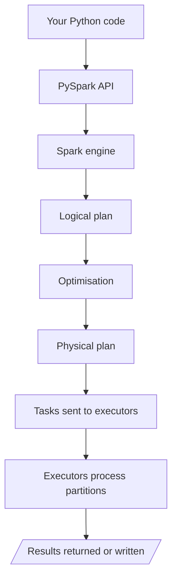

# 05 · PySpark

**← Previous** [04 · Apache Spark](04-apache-spark.md) · [🏠 Home](../README.md) · **Next →** [06 · Databricks](06-databricks.md)

> **In this chapter:** what PySpark is, how it differs from Pandas, and what really happens when you run it.
> ⏱️ 15 minutes · 🎯 Level: beginner · 🧪 Code: [`pandas_vs_pyspark.py`](../examples/local/pandas_vs_pyspark.py)

## Table of contents

- [What is PySpark](#what-is-pyspark)
- [Pandas vs PySpark](#pandas-vs-pyspark)
- [Same task, two tools](#same-task-two-tools)
- [How PySpark really works](#how-pyspark-really-works)
- [Key takeaways](#key-takeaways)

---

## What is PySpark

**PySpark is the Python API for Apache Spark.** If you already know Python, Pandas and NumPy, PySpark lets you use that skill to drive a cluster. It is **not** a separate engine; it is a Python front door to Spark.

## Pandas vs PySpark

| Pandas | PySpark |
| --- | --- |
| Mainly single-machine DataFrames | Distributed DataFrames |
| Data held in local memory | Data processed across Spark executors |
| Great for small to medium data that fits your machine | Built for large-scale workloads |
| Eager: runs each operation immediately | Lazy: waits until an action |

> ⚖️ **Fair warning:** Pandas can handle fairly large data on a strong machine, and PySpark can run on a single machine. For small data Pandas is often *faster* (Spark has startup and scheduling overhead). The real difference is architecture and the ability to scale out.

## Same task, two tools

**Question:** total revenue per city from [`data/sales_sample.csv`](../data/sales_sample.csv).

```python
# Pandas
import pandas as pd

pdf = pd.read_csv("data/sales_sample.csv")
result = pdf.groupby("city")["revenue"].sum().sort_values(ascending=False)
print(result)
```

```python
# PySpark
from pyspark.sql import functions as F

sdf = spark.read.csv("data/sales_sample.csv", header=True, inferSchema=True)
result = (
    sdf.groupBy("city")
       .agg(F.sum("revenue").alias("total_revenue"))
       .orderBy(F.desc("total_revenue"))
)
result.show()
```

**Output** (identical numbers from both tools):

```text
+---------+-------------+
|     city|total_revenue|
+---------+-------------+
|  Chennai|        90100|
|   Mumbai|        82900|
|Hyderabad|        41900|
|    Delhi|        39600|
|Bangalore|        39000|
+---------+-------------+
```

The business logic is the same. The difference is that Spark can spread the work across a cluster.

Run both side by side: `python examples/local/pandas_vs_pyspark.py`

## How PySpark really works

Your Python code does **not** crunch the data itself. It *describes* work, and the Spark engine executes it.



1. You write Python instructions.
2. PySpark hands them to the Spark engine.
3. Spark builds a **logical plan**.
4. Spark **optimises** the plan.
5. Spark creates a **physical plan** and schedules tasks on executors.
6. Executors process the data partitions.
7. Results are returned or written to storage.

That is why PySpark is not "a Python library for big files". It is a **Python interface to a distributed engine**.

## Key takeaways

- PySpark = Python API for Spark, not a new engine.
- Same logic as Pandas, different execution model (distributed and lazy).
- Choose by data size and need to scale, not by habit.

---

**← Previous** [04 · Apache Spark](04-apache-spark.md) · [🏠 Home](../README.md) · **Next →** [06 · Databricks](06-databricks.md)
