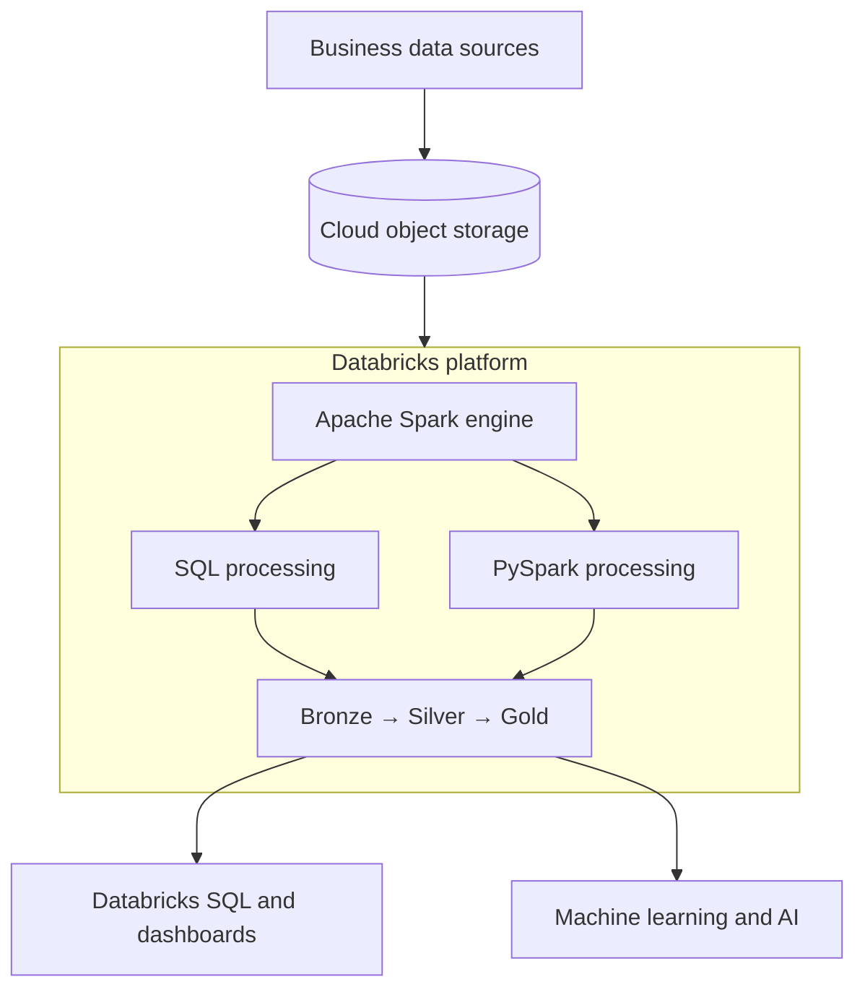
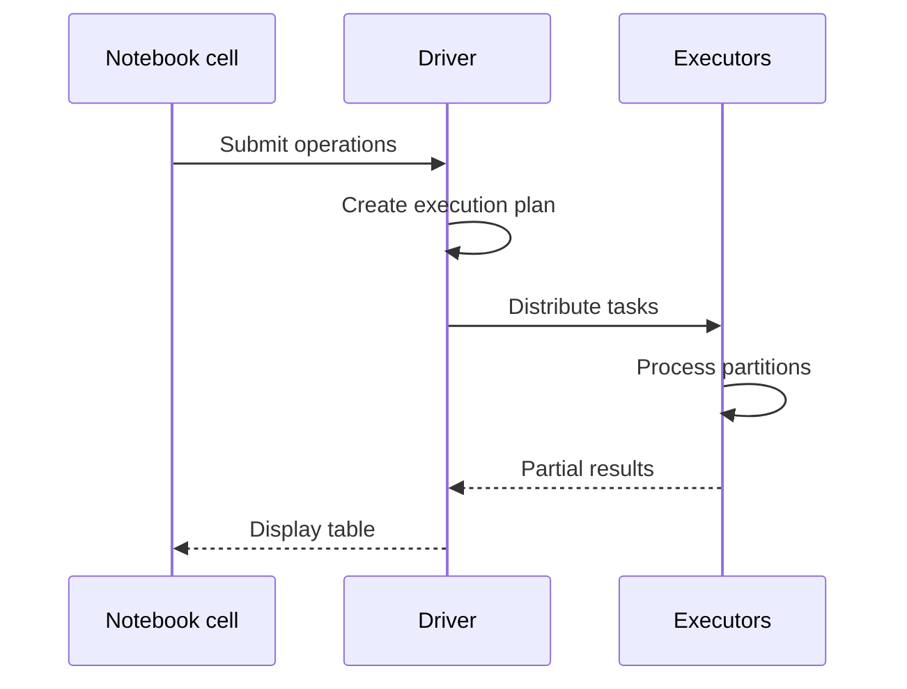

# 06 · Databricks

**← Previous** [05 · PySpark](05-pyspark.md) · [🏠 Home](../README.md) · **Next →** [07 · Lakehouse, Delta Lake and Medallion](07-lakehouse-delta-medallion.md)

> **In this chapter:** why a processing engine alone isn't enough, and what Databricks adds.
> ⏱️ 15 minutes · 🎯 Level: beginner

## Table of contents

- [Why a platform](#why-a-platform)
- [Building blocks](#building-blocks)
- [Driver and workers in Databricks](#driver-and-workers-in-databricks)
- [What happens when you run a cell](#what-happens-when-you-run-a-cell)
- [Key takeaways](#key-takeaways)

---

## Why a platform

Real projects need far more than an engine:

| Need | Provided by Databricks |
| --- | --- |
| A place to store data | Cloud object storage + managed tables |
| A computing environment | Managed compute (clusters, serverless) |
| A place to write code | Notebooks, files, repos |
| Control over data access | Unity Catalog |
| Pipelines | Jobs, Lakeflow Spark Declarative Pipelines |
| Scheduling and monitoring | Jobs, run history, alerts |
| Analytics | Databricks SQL, dashboards |

> ℹ️ Databricks is **not** a replacement for every storage system. It typically sits on cloud object storage and uses Spark for computation.



## Building blocks

| Component | Responsibility |
| --- | --- |
| **Workspace** | Organises notebooks, queries, files and other assets |
| **Notebook** | Write and run Python, SQL and other supported languages |
| **Compute** | Provides the machines that run your workload |
| **Driver / Workers** | Coordinate (driver) and execute (workers) Spark work |
| **Spark engine** | Runs distributed data operations |
| **Unity Catalog** | Central governance: permissions, lineage, data organisation |
| **Delta Lake** | Reliable table storage with transactions |

## Driver and workers in Databricks

When a notebook is attached to multi-node compute:

- the **driver** coordinates your notebook's Spark work,
- Spark distributes tasks to **executors**,
- executors run on **worker** resources,
- results are collected or written to the destination.

A single-node configuration can also run Spark. Multi-node compute is where horizontal scaling becomes visible.

## What happens when you run a cell

```python
df = spark.read.table("etl_pipeline.bronze.sales")
result = df.groupBy("city").count()
display(result)
```



## Key takeaways

- Databricks packages storage access, compute, code, governance, orchestration and analytics around Spark.
- Driver coordinates, executors work, Unity Catalog governs.
- You still write ordinary PySpark and SQL; the platform handles the infrastructure.

---

**← Previous** [05 · PySpark](05-pyspark.md) · [🏠 Home](../README.md) · **Next →** [07 · Lakehouse, Delta Lake and Medallion](07-lakehouse-delta-medallion.md)
