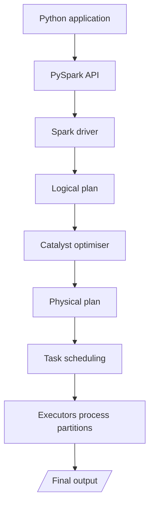

# 06 · PySpark

**← Previous** [05 · Apache Spark](05-apache-spark.md) · [🏠 Home](../README.md) · **Next →** [07 · Databricks, Lakehouse and Medallion](07-databricks-lakehouse-medallion.md)

> **In this chapter:** what PySpark is, how it differs from Pandas, and what really happens when Python code drives Spark.
> ⏱️ 20 minutes · 🎯 Level: beginner · 💻 No code in this chapter (side-by-side code is in [Hands-On](11-hands-on-guide.md#pandas-vs-pyspark-side-by-side))

## Learning objectives

By the end of this chapter you can:

1. define PySpark and explain why it exists,
2. compare Pandas and PySpark fairly,
3. describe the steps from Python statement to distributed execution.

## Table of contents

- [What is PySpark](#what-is-pyspark)
- [Why PySpark](#why-pyspark)
- [Pandas vs PySpark](#pandas-vs-pyspark)
- [How PySpark works internally](#how-pyspark-works-internally)
- [Key takeaways](#key-takeaways)

---

## What is PySpark

> **Definition:** PySpark is the **Python API for Apache Spark**. It lets developers use Python to perform distributed data processing and analytics.

Many data engineers prefer Python for its simplicity, readability and ecosystem. The natural question: *can we use Python to drive distributed processing?* Yes. PySpark provides Python interfaces to Spark, so Python code uses the Spark execution engine. PySpark is **not** a separate engine.

## Why PySpark

PySpark is useful for:

- large datasets,
- distributed data transformations,
- data cleaning and preparation,
- ETL pipelines,
- complex joins and aggregations,
- batch and streaming data,
- preparing data for machine learning.

## Pandas vs PySpark

| | Pandas | PySpark |
| --- | --- | --- |
| **What it is** | Python library for data manipulation, mainly in-memory DataFrames on one machine | Python API that uses Spark’s distributed execution engine |
| **Execution** | Primarily local | Distributed, or local Spark |
| **Data processing** | Single-machine DataFrame operations | Distributed DataFrame operations |
| **Memory** | Local system memory | Spark execution resources |
| **Scalability** | Limited by local resources for conventional workflows | Cluster-based scaling |
| **Evaluation** | Eager: runs each operation immediately | Lazy: waits for an action |
| **Best suited for** | Local data analysis | Large-scale distributed processing |

> ⚖️ **Fair warning:** Pandas can handle fairly large data on a powerful machine, and PySpark can run on a single machine. For small datasets Pandas is often *faster* because Spark has start-up and scheduling overhead. The real difference is architecture and the ability to scale out.

**Business example.** Asked for *total sales revenue by city* on four orders (Hyderabad 500, Mumbai 700, Hyderabad 300, Bangalore 800), both tools give the same answer:

| City | Total revenue |
| --- | --- |
| Hyderabad | 800 |
| Mumbai | 700 |
| Bangalore | 800 |

The business logic is identical; what differs is where and how it runs. See the [code side by side](11-hands-on-guide.md#pandas-vs-pyspark-side-by-side).

## How PySpark works internally

Your Python statements are **not** each executed as distributed Python. Instead:

| Step | What happens |
| --- | --- |
| 1 · Python application | The developer writes code using PySpark APIs |
| 2 · PySpark API | PySpark communicates the requested operations to Spark |
| 3 · Logical plan | Spark builds a logical representation of the operations |
| 4 · Query optimisation | For Spark SQL and DataFrame operations, the **Catalyst optimiser** analyses and optimises the plan |
| 5 · Physical plan | Spark decides how to execute the operations |
| 6 · Distributed execution | Tasks are scheduled across available executors |
| 7 · Results | Data is returned, displayed or written to storage |

> 🔧 **Technical note:** DataFrame operations are represented in Spark’s own execution engine and run efficiently. Python UDFs (user-defined functions) and RDD operations behave differently: some involve Python worker processes and can be slower.

## Key takeaways

- PySpark is the Python API for Spark, not a new engine.
- Same business logic as Pandas, but a distributed, lazy, optimised execution model.
- Choose by data size and the need to scale, not by habit.

---

**← Previous** [05 · Apache Spark](05-apache-spark.md) · [🏠 Home](../README.md) · **Next →** [07 · Databricks, Lakehouse and Medallion](07-databricks-lakehouse-medallion.md)
