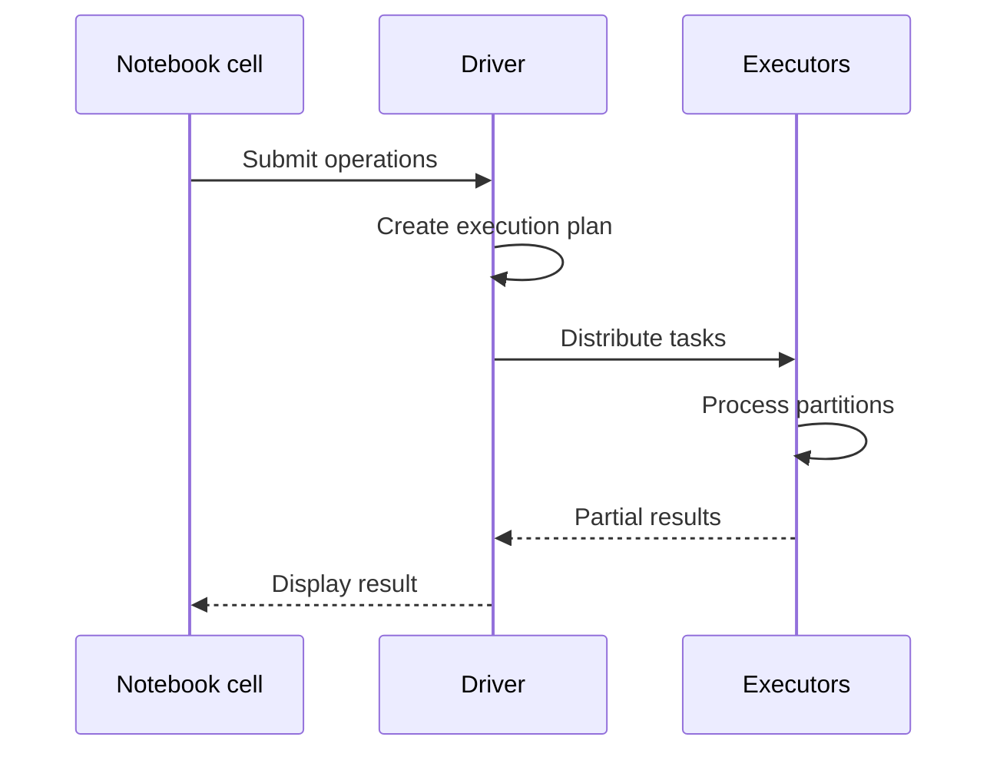
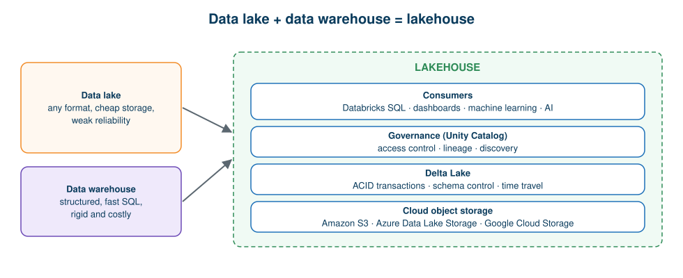
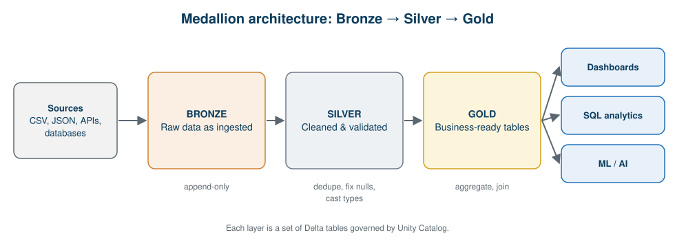

# 07 · Databricks, Delta Lake, Lakehouse and Medallion Architecture

**← Previous** [06 · PySpark](06-pyspark.md) · [🏠 Home](../README.md) · **Next →** [08 · Chapter Summary](08-chapter-summary.md)

> **In this chapter:** the platform that wraps Spark for real projects, the storage layer that makes data lakes reliable, and the layered design used in modern pipelines.
> ⏱️ 35 minutes · 🎯 Level: beginner–intermediate · 💻 No code in this chapter (the pipeline is built in [Hands-On](11-hands-on-guide.md#bronze--silver--gold-pipeline))

## Learning objectives

By the end of this chapter you can:

1. explain what Databricks is and why teams use it,
2. list its major components,
3. explain what Delta Lake adds to a data lake,
4. describe the lakehouse and Medallion (Bronze, Silver, Gold) architectures.

## Table of contents

- [What is Databricks](#what-is-databricks)
- [Databricks architecture](#databricks-architecture)
- [Delta Lake](#delta-lake)
- [Lakehouse architecture](#lakehouse-architecture)
- [Medallion architecture](#medallion-architecture)
- [Key takeaways](#key-takeaways)

---

## What is Databricks

> **Definition:** Databricks is a cloud-based data and AI platform that provides an integrated environment for data engineering, analytics, machine learning and AI workloads.

Production data engineering needs more than processing code. Organisations also need:

- development environments,
- computing resources,
- data-storage integration,
- data governance,
- pipeline development,
- job scheduling and orchestration,
- monitoring and analytics.

**Why teams choose it.** Suppose our e-commerce company wants a complete ETL pipeline. It must extract data from different sources, store raw data, clean and transform it, create analytical datasets, schedule runs, monitor failures and produce dashboards. Databricks provides tools for each of these activities.

## Databricks architecture

| Component | Definition and responsibility |
| --- | --- |
| **Workspace** | Environment for organising notebooks, queries and other development assets |
| **Notebook** | Interactive environment for writing and running code |
| **Compute** | Computing resources that execute workloads |
| **Spark engine** | Distributed data-processing engine |
| **Driver** | Coordinates Spark application execution |
| **Workers** | Provide computing resources for distributed processing |
| **Unity Catalog** | Centralised data governance and access management |
| **Delta Lake** | Reliable table storage with transaction capabilities |
| **Databricks SQL** | SQL analytics and querying environment |
| **Lakeflow** | Capabilities for building and orchestrating data pipelines |

**How it works in practice**

1. A data engineer opens a Databricks workspace.
2. They create a notebook.
3. The notebook is attached to suitable compute.
4. Python or SQL instructions are written.
5. Spark executes the supported data-processing operations.
6. Data is read from or written to storage.
7. Results feed analytics and reporting.

> ℹ️ Databricks is **not** a replacement for every storage system. It typically sits on **cloud object storage** and uses Spark for computation. A single-node compute can run Spark too; multi-node compute is where horizontal scaling becomes visible.

## Delta Lake

> **Definition:** Delta Lake is an open-source storage framework that brings reliability and transactions to data lakes by keeping a **transaction log** alongside the data files.

**Why it exists.** Traditional data lakes hold plain files (CSV, JSON, Parquet). Managing concurrent writes, schema changes and consistent updates on plain files is hard.

| Feature | Explanation |
| --- | --- |
| **ACID transactions** | Reliable operations: a write fully succeeds or fully fails |
| **Schema enforcement** | Incoming data must match the expected schema |
| **Schema evolution** | Controlled, explicit schema changes |
| **Time travel** | Query earlier versions of a table |
| **Transaction log** | Records table changes and history |
| **Updates and deletes** | Existing table data can be modified |

## Lakehouse architecture

> **Definition:** a lakehouse combines the flexibility and scalability of data lakes with the data-management and analytics capabilities traditionally associated with data warehouses.

| | Data lake | Data warehouse | Lakehouse |
| --- | --- | --- | --- |
| **Storage** | Flexible; often object storage | Structured, often managed warehouse storage | Lake storage with added table management |
| **Data formats** | Many (CSV, JSON, Parquet, images, logs) | Structured analytical data | Many, with reliable tables |
| **Strength** | Cheap, flexible | Fast analytical queries and BI | Supports multiple workloads on one platform |
| **Weakness** | Weak reliability and governance | Rigid, can be costly | Needs good design and governance |

**Storage evolution at a glance**

| Era | Storage |
| --- | --- |
| Traditional big data | Hadoop **HDFS** |
| Cloud data lake | **Object storage** (Amazon S3, Azure Data Lake Storage, Google Cloud Storage) |
| Lakehouse | Data lake + **Delta Lake** + governance + compute |

## Medallion architecture

> **Definition:** the Medallion architecture is a design pattern that organises data into layers, commonly **Bronze, Silver and Gold**, to progressively improve data quality and business readiness.

| Layer | Purpose | Typical examples |
| --- | --- | --- |
| 🥉 **Bronze** (raw) | Stores ingested source data, usually preserving its original structure and traceability to the source | Raw customer data, original sales records, transaction files, application logs |
| 🥈 **Silver** (cleaned) | Cleaned, validated and transformed data, ready for downstream processing | Duplicates removed, missing values handled, data types standardised, invalid records addressed |
| 🥇 **Gold** (business-ready) | Curated, aggregated datasets for reporting, analytics and other consumption | Revenue by city, monthly sales trends, customer purchase analysis, product performance |

**Retail sales example**

| Layer | Example table | Transformation |
| --- | --- | --- |
| Bronze | `bronze_sales` | Load the original sales data |
| Silver | `silver_sales` | Clean dates, nulls and duplicates |
| Gold | `gold_city_revenue` | Aggregate revenue by city |

**Why layers?** If a cleaning rule changes, Silver and Gold can be rebuilt from Bronze without re-collecting data. Bronze is the safety net.

## Key takeaways

- Databricks wraps Spark with compute, notebooks, governance, orchestration and analytics.
- Delta Lake adds reliability (ACID, schema control, time travel) to plain files.
- The lakehouse unifies lake flexibility with warehouse-style management.
- Medallion layers move data from raw to trusted, business-ready.

---

**← Previous** [06 · PySpark](06-pyspark.md) · [🏠 Home](../README.md) · **Next →** [08 · Chapter Summary](08-chapter-summary.md)
