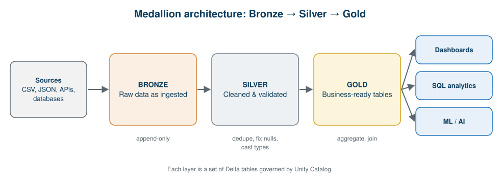
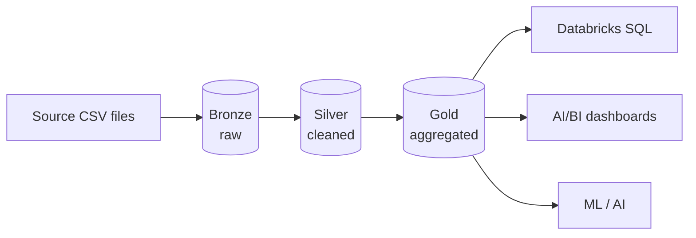

# 07 · From HDFS to the Lakehouse: Delta Lake and Medallion Architecture

**← Previous** [06 · Databricks](06-databricks.md) · [🏠 Home](../README.md) · **Next →** [08 · Hands-On Guide](08-hands-on-guide.md)

> **In this chapter:** how storage evolved, what Delta Lake adds, and how Bronze → Silver → Gold organises a pipeline.
> ⏱️ 20 minutes · 🎯 Level: beginner–intermediate · 🧪 Code: [`retail_medallion_pipeline.py`](../examples/local/retail_medallion_pipeline.py), [`04_medallion_pipeline.py`](../notebooks/04_medallion_pipeline.py)

## Table of contents

- [Evolution of storage](#evolution-of-storage)
- [What Delta Lake adds](#what-delta-lake-adds)
- [Medallion architecture](#medallion-architecture)
- [Run the pipeline locally](#run-the-pipeline-locally)
- [Run it on Databricks](#run-it-on-databricks)
- [Key takeaways](#key-takeaways)

---

## Evolution of storage

| Era | Storage | Idea |
| --- | --- | --- |
| Traditional big data | **Hadoop HDFS** | Blocks on DataNodes, tracked by the NameNode |
| Cloud data lake | **Object storage** (Amazon S3, Azure Data Lake Storage, Google Cloud Storage) | Cheap, scalable files such as CSV, JSON, Parquet |
| **Lakehouse** | Data lake + Delta Lake + governance + compute | Flexible storage *plus* reliable tables and analytics |

## What Delta Lake adds

Plain files in object storage have no transactions. Delta Lake adds a transaction log on top of them:

| Capability | Why it matters |
| --- | --- |
| **ACID transactions** | A write either fully succeeds or fully fails; no half-written tables |
| **Schema enforcement** | Bad data is rejected instead of silently corrupting a table |
| **Schema evolution** | Controlled, explicit changes to table structure |
| **Time travel** | Query or restore earlier versions of a table |
| **Concurrent reads and writes** | Readers see consistent data while writers work |

```python
# Save a DataFrame as a Delta table
(
    df.write
      .format("delta")
      .mode("overwrite")
      .saveAsTable("etl_pipeline.bronze.sales")
)
```

```sql
-- Inspect the table's version history (time travel)
DESCRIBE HISTORY etl_pipeline.bronze.sales;
```

## Medallion architecture



| Layer | Purpose | Typical operations | Example |
| --- | --- | --- | --- |
| 🥉 **Bronze** | Store ingested raw data as-is | Append, add metadata columns | Original sales records |
| 🥈 **Silver** | Clean and standardise | Deduplicate, fix types, handle nulls, validate | Duplicates removed, cities standardised |
| 🥇 **Gold** | Business-ready datasets | Aggregate, join, model | Revenue by city and product |



**Why layers?** If a cleaning rule changes, you can rebuild Silver and Gold from Bronze without re-collecting the data. Bronze is your safety net.

## Run the pipeline locally

The input [`data/sales_raw_dirty.csv`](../data/sales_raw_dirty.csv) has deliberate problems:

| Problem | Example rows | How Silver handles it |
| --- | --- | --- |
| Exact duplicate rows | orders 1003 and 1006 | `dropDuplicates()` |
| Missing city | order 1009 | filtered out |
| Messy city text | `" mumbai "`, `"HYDERABAD"` | `trim` + `initcap` |
| Missing quantity | order 1022 | filtered out |
| Negative revenue | order 1019 | filtered out |

```bash
python examples/local/retail_medallion_pipeline.py
```

**Output:**

```text
BRONZE rows: 32
SILVER rows: 27  (rejected 5)

GOLD: revenue by city
+---------+------+-------------+---------------+
|     city|orders|total_revenue|avg_order_value|
+---------+------+-------------+---------------+
|   Mumbai|     8|        44400|         5550.0|
|  Chennai|     7|        37600|         5371.4|
|Hyderabad|     5|        30400|         6080.0|
|    Delhi|     6|        17300|         2883.3|
|Bangalore|     1|         1800|         1800.0|
+---------+------+-------------+---------------+

GOLD: late deliveries by city
+---------+-----------+------+--------+
|     city|late_orders|orders|late_pct|
+---------+-----------+------+--------+
|   Mumbai|          5|     8|    62.5|
|    Delhi|          3|     6|    50.0|
|  Chennai|          3|     7|    42.9|
|Bangalore|          0|     1|     0.0|
|Hyderabad|          0|     5|     0.0|
+---------+-----------+------+--------+
```

The core of the Silver step:

```python
silver = (
    spark.read.parquet("output/bronze/sales")
    .dropDuplicates()                                           # exact duplicates
    .withColumn("city", F.initcap(F.trim(F.col("city"))))       # ' mumbai ' -> 'Mumbai'
    .filter(F.col("city").isNotNull() & (F.col("city") != ""))  # missing city
    .filter(F.col("quantity").isNotNull())                      # missing quantity
    .filter(F.col("revenue") > 0)                               # invalid revenue
)
```

> 🔎 **Why 5 rejected?** 2 duplicates + 1 missing city + 1 missing quantity + 1 negative revenue = 5. The two messy city names are *repaired*, not rejected.

## Run it on Databricks

[`notebooks/04_medallion_pipeline.py`](../notebooks/04_medallion_pipeline.py) does the same with Delta tables in Unity Catalog (`catalog.bronze.sales`, `catalog.silver.sales`, `catalog.gold.revenue_by_city`). Import it into your workspace, set the two widgets (catalog and CSV path) and run all cells. See [Chapter 08](08-hands-on-guide.md#running-on-databricks) for setup.

## Key takeaways

- HDFS → object storage → lakehouse: storage became cheaper and table features moved into software (Delta Lake).
- Delta Lake adds ACID, schema control and time travel to plain files.
- Medallion layers make pipelines rebuildable, testable and understandable.

---

**← Previous** [06 · Databricks](06-databricks.md) · [🏠 Home](../README.md) · **Next →** [08 · Hands-On Guide](08-hands-on-guide.md)
