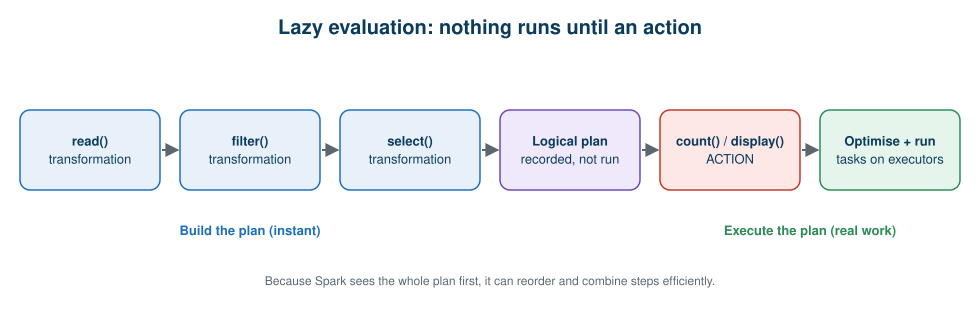

# 08 · Hands-On Guide

**← Previous** [07 · Lakehouse, Delta Lake and Medallion](07-lakehouse-delta-medallion.md) · [🏠 Home](../README.md) · **Next →** [09 · Real-World Use Cases](09-real-world-use-cases.md)

> **In this chapter:** create a DataFrame, inspect partitions, transform data, and understand lazy evaluation and execution plans.
> ⏱️ 30 minutes · 🎯 Level: beginner · 🧪 Code: [`pyspark_first_steps.py`](../examples/local/pyspark_first_steps.py), [`lazy_evaluation_demo.py`](../examples/local/lazy_evaluation_demo.py)

## Table of contents

- [Choose where to run](#choose-where-to-run)
- [Step 1: create a DataFrame](#step-1-create-a-dataframe)
- [Step 2: look at partitions](#step-2-look-at-partitions)
- [Step 3: transform the data](#step-3-transform-the-data)
- [Step 4: understand lazy evaluation](#step-4-understand-lazy-evaluation)
- [Step 5: read the execution plan](#step-5-read-the-execution-plan)
- [Running on Databricks](#running-on-databricks)
- [Troubleshooting](#troubleshooting)

---

## Choose where to run

| Option | Setup | Best for |
| --- | --- | --- |
| **Local** | `pip install -r requirements.txt` + Java 17+ | Quick experiments, no account needed |
| **Databricks** | Workspace + compute | The real platform experience |

All commands below assume you are at the repository root.

## Step 1: create a DataFrame

```python
data = [
    (101, "Hyderabad", 500),
    (102, "Mumbai", 700),
    (103, "Hyderabad", 300),
    (104, "Bangalore", 800),
    (105, "Mumbai", 200),
    (106, "Hyderabad", 400),
]
df = spark.createDataFrame(data, ["order_id", "city", "revenue"])
df.show()
```

```text
+--------+---------+-------+
|order_id|     city|revenue|
+--------+---------+-------+
|     101|Hyderabad|    500|
|     102|   Mumbai|    700|
|     103|Hyderabad|    300|
|     104|Bangalore|    800|
|     105|   Mumbai|    200|
|     106|Hyderabad|    400|
+--------+---------+-------+
```

A **Spark DataFrame** is a distributed collection of data organised into named columns. (On Databricks use `display(df)` for an interactive table.)

## Step 2: look at partitions

```python
df = df.repartition(3)
print("Partitions:", df.rdd.getNumPartitions())
```

```text
Partitions: 3
```

> 🧠 **Remember:** three partitions does **not** mean three machines. Partitions are logical slices; Spark decides which executors run their tasks.

> ⚠️ **Serverless note:** on Databricks serverless compute, `df.rdd` is not available. Use this instead:
>
> ```python
> from pyspark.sql import functions as F
> df.withColumn("pid", F.spark_partition_id()).groupBy("pid").count().show()
> ```

## Step 3: transform the data

```python
from pyspark.sql import functions as F

# Filter
df.filter(F.col("revenue") > 300).show()

# Aggregate
(
    df.groupBy("city")
      .agg(F.sum("revenue").alias("total_revenue"))
      .orderBy(F.desc("total_revenue"))
      .show()
)
```

```text
+--------+---------+-------+
|order_id|     city|revenue|
+--------+---------+-------+
|     101|Hyderabad|    500|
|     102|   Mumbai|    700|
|     104|Bangalore|    800|
|     106|Hyderabad|    400|
+--------+---------+-------+

+---------+-------------+
|     city|total_revenue|
+---------+-------------+
|Hyderabad|         1200|
|   Mumbai|          900|
|Bangalore|          800|
+---------+-------------+
```

## Step 4: understand lazy evaluation

Spark DataFrame transformations are **lazy**: they record what you want and build a plan. Nothing is processed until an **action** runs.



```python
df = spark.read.csv("data/sales_sample.csv", header=True, inferSchema=True)

filtered = df.filter(F.col("revenue") > 5000)                 # transformation
selected = filtered.select("order_id", "city", "revenue")     # transformation
# ...no data has been processed yet...

print(selected.count())                                        # ACTION → runs now
```

| Transformations (build the plan) | Actions (run the plan) |
| --- | --- |
| `select()` | `count()` |
| `filter()` | `show()` |
| `groupBy()` | `collect()` |
| `withColumn()` | `write` operations |
| `drop()` | `display()` in a notebook |

**Why lazy?** Because Spark sees your whole plan first, it can reorder and combine steps. In the next step you'll see Spark pushing the filter down into the file scan.

## Step 5: read the execution plan

```python
selected.explain(mode="formatted")
```

```text
== Physical Plan ==
* Filter (2)
+- Scan csv  (1)

(1) Scan csv
Output [3]: [order_id, city, revenue]
PushedFilters: [IsNotNull(revenue), GreaterThan(revenue,5000)]
ReadSchema: struct<order_id:int,city:string,revenue:int>

(2) Filter [codegen id : 1]
Condition : (isnotnull(revenue) AND (revenue > 5000))
```

*(Output trimmed; internal ids like `#17` removed for readability.)*

**Questions to ask of any plan:**

| Question | What you saw above |
| --- | --- |
| Which operations run? | A scan and a filter |
| Is there a filter? | Yes, `revenue > 5000` |
| Which columns are read? | Only `order_id`, `city`, `revenue` (**column pruning**: the `select` was pushed into the scan) |
| Is the filter pushed to the scan? | Yes, see `PushedFilters` |
| Is there a shuffle (`Exchange`)? | No. Add a `groupBy` and run `explain()` again to see one. |

Run it yourself: `python examples/local/lazy_evaluation_demo.py`

## Running on Databricks

1. **Create or open a workspace** and make sure you have compute available (serverless or a cluster).
2. **Import the notebooks:** *Workspace → Import* and choose the files in [`notebooks/`](../notebooks/). They are in Databricks source format.
3. **Upload the data:** create a Unity Catalog **Volume** and upload [`data/sales_sample.csv`](../data/sales_sample.csv) (and `sales_raw_dirty.csv` for notebook 04).
4. **Update the path** in the notebook, e.g. `/Volumes/<catalog>/<schema>/<volume>/sales_sample.csv`.
5. **Run all cells** from the top.

| Notebook | Purpose |
| --- | --- |
| [`01_first_dataframe.py`](../notebooks/01_first_dataframe.py) | Create, partition, filter, aggregate |
| [`02_lazy_evaluation_and_explain.py`](../notebooks/02_lazy_evaluation_and_explain.py) | Transformations vs actions, `explain()` |
| [`03_retail_sales_analysis.py`](../notebooks/03_retail_sales_analysis.py) | The five management questions |
| [`04_medallion_pipeline.py`](../notebooks/04_medallion_pipeline.py) | Bronze → Silver → Gold with Delta |

## Troubleshooting

| Symptom | Likely cause | Fix |
| --- | --- | --- |
| `JAVA_HOME is not set` / Java errors locally | PySpark needs Java | Install JDK 17 or newer |
| `FutureWarning` about pandas ≥ 3 | Newer pandas with PySpark | `pip install "pandas<3"` (already pinned in `requirements.txt`) |
| `FileNotFound` for `data/...` | Wrong working directory | Run from the repository root |
| `df.rdd` fails on Databricks | Serverless compute | Use `F.spark_partition_id()` as shown above |
| Path not found in notebook | Placeholder path unchanged | Replace `<catalog>/<schema>/<volume>` |

---

**← Previous** [07 · Lakehouse, Delta Lake and Medallion](07-lakehouse-delta-medallion.md) · [🏠 Home](../README.md) · **Next →** [09 · Real-World Use Cases](09-real-world-use-cases.md)
