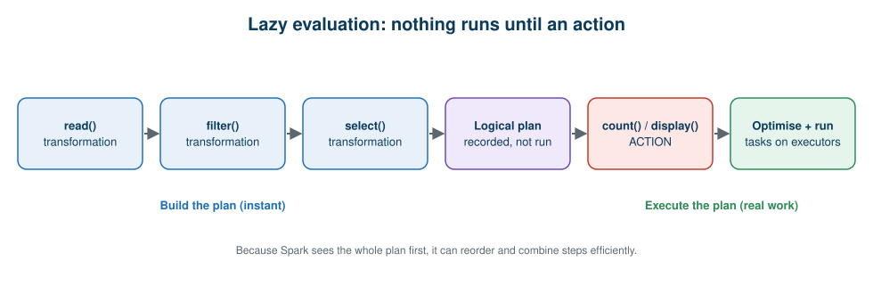

# 11 · Hands-On Guide

**← Previous** [10 · Knowledge Check](10-knowledge-check.md) · [🏠 Home](../README.md) · **Next →** [12 · Real-World Use Cases](12-real-world-use-cases.md)

> **In this chapter:** the coding part of the course. You apply the ideas from the concept chapters (01–08): create a DataFrame, inspect partitions, transform data, read execution plans, and build a Bronze → Silver → Gold pipeline.
> ⏱️ 45 minutes · 🎯 Level: beginner · 🧪 Code: [`pyspark_first_steps.py`](../examples/local/pyspark_first_steps.py), [`lazy_evaluation_demo.py`](../examples/local/lazy_evaluation_demo.py)

## Table of contents

- [Choose where to run](#choose-where-to-run)
- [Step 1: create a DataFrame](#step-1-create-a-dataframe)
- [Step 2: look at partitions](#step-2-look-at-partitions)
- [Step 3: transform the data](#step-3-transform-the-data)
- [Step 4: understand lazy evaluation](#step-4-understand-lazy-evaluation)
- [Step 5: read the execution plan](#step-5-read-the-execution-plan)
- [Pandas vs PySpark side by side](#pandas-vs-pyspark-side-by-side)
- [MapReduce in plain Python](#mapreduce-in-plain-python)
- [Bronze → Silver → Gold pipeline](#bronze--silver--gold-pipeline)
- [Running on Databricks](#running-on-databricks)
- [Troubleshooting](#troubleshooting)

---

## Choose where to run

| Option | Setup | Best for |
| --- | --- | --- |
| **Local** | `pip install -r requirements.txt` + Java 17+ | Quick experiments, no account needed |
| **Databricks** | Workspace + compute | The real platform experience |

All commands below assume you are at the repository root.

## Step 1: create a DataFrame

```python
data = [
    (101, "Hyderabad", 500),
    (102, "Mumbai", 700),
    (103, "Hyderabad", 300),
    (104, "Bangalore", 800),
    (105, "Mumbai", 200),
    (106, "Hyderabad", 400),
]
df = spark.createDataFrame(data, ["order_id", "city", "revenue"])
df.show()
```

```text
+--------+---------+-------+
|order_id|     city|revenue|
+--------+---------+-------+
|     101|Hyderabad|    500|
|     102|   Mumbai|    700|
|     103|Hyderabad|    300|
|     104|Bangalore|    800|
|     105|   Mumbai|    200|
|     106|Hyderabad|    400|
+--------+---------+-------+
```

A **Spark DataFrame** is a distributed collection of data organised into named columns. (On Databricks use `display(df)` for an interactive table.)

Inspect the structure and count the rows:

```python
df.printSchema()
print(df.count())
```

```text
root
 |-- order_id: long (nullable = true)
 |-- city: string (nullable = true)
 |-- revenue: long (nullable = true)

6
```


## Step 2: look at partitions

```python
df = df.repartition(3)
print("Partitions:", df.rdd.getNumPartitions())
```

```text
Partitions: 3
```

> 🧠 **Remember:** three partitions does **not** mean three machines. Partitions are logical slices; Spark decides which executors run their tasks.

> ⚠️ **Serverless note:** on Databricks serverless compute, `df.rdd` is not available. Use this instead:
>
> ```python
> from pyspark.sql import functions as F
> df.withColumn("pid", F.spark_partition_id()).groupBy("pid").count().show()
> ```

## Step 3: transform the data

```python
from pyspark.sql import functions as F

# Filter
df.filter(F.col("revenue") > 300).show()

# Aggregate
(
    df.groupBy("city")
      .agg(F.sum("revenue").alias("total_revenue"))
      .orderBy(F.desc("total_revenue"))
      .show()
)
```

```text
+--------+---------+-------+
|order_id|     city|revenue|
+--------+---------+-------+
|     101|Hyderabad|    500|
|     102|   Mumbai|    700|
|     104|Bangalore|    800|
|     106|Hyderabad|    400|
+--------+---------+-------+

+---------+-------------+
|     city|total_revenue|
+---------+-------------+
|Hyderabad|         1200|
|   Mumbai|          900|
|Bangalore|          800|
+---------+-------------+
```

## Step 4: understand lazy evaluation

Spark DataFrame transformations are **lazy**: they record what you want and build a plan. Nothing is processed until an **action** runs.



```python
df = spark.read.csv("data/sales_sample.csv", header=True, inferSchema=True)

filtered = df.filter(F.col("revenue") > 5000)                 # transformation
selected = filtered.select("order_id", "city", "revenue")     # transformation
# ...no data has been processed yet...

print(selected.count())                                        # ACTION → runs now
```

| Transformations (build the plan) | Actions (run the plan) |
| --- | --- |
| `select()` | `count()` |
| `filter()` | `show()` |
| `groupBy()` | `collect()` |
| `withColumn()` | `write` operations |
| `drop()` | `display()` in a notebook |

**Why lazy?** Because Spark sees your whole plan first, it can reorder and combine steps. In the next step you'll see Spark pushing the filter down into the file scan.

## Step 5: read the execution plan

```python
selected.explain(mode="formatted")
```

```text
== Physical Plan ==
* Filter (2)
+- Scan csv  (1)

(1) Scan csv
Output [3]: [order_id, city, revenue]
PushedFilters: [IsNotNull(revenue), GreaterThan(revenue,5000)]
ReadSchema: struct<order_id:int,city:string,revenue:int>

(2) Filter [codegen id : 1]
Condition : (isnotnull(revenue) AND (revenue > 5000))
```

*(Output trimmed; internal ids like `#17` removed for readability.)*

**Questions to ask of any plan:**

| Question | What you saw above |
| --- | --- |
| Which operations run? | A scan and a filter |
| Is there a filter? | Yes, `revenue > 5000` |
| Which columns are read? | Only `order_id`, `city`, `revenue` (**column pruning**: the `select` was pushed into the scan) |
| Is the filter pushed to the scan? | Yes, see `PushedFilters` |
| Is there a shuffle (`Exchange`)? | No. Add a `groupBy` and run `explain()` again to see one. |

Run it yourself: `python examples/local/lazy_evaluation_demo.py`

## Pandas vs PySpark side by side

Concepts are explained in [Chapter 06](06-pyspark.md). **Question:** total revenue per city from [`data/sales_sample.csv`](../data/sales_sample.csv).

```python
# Pandas
import pandas as pd

pdf = pd.read_csv("data/sales_sample.csv")
result = pdf.groupby("city")["revenue"].sum().sort_values(ascending=False)
print(result)
```

```python
# PySpark
from pyspark.sql import functions as F

sdf = spark.read.csv("data/sales_sample.csv", header=True, inferSchema=True)
result = (
    sdf.groupBy("city")
       .agg(F.sum("revenue").alias("total_revenue"))
       .orderBy(F.desc("total_revenue"))
)
result.show()
```

**Output** (identical numbers from both tools):

```text
+---------+-------------+
|     city|total_revenue|
+---------+-------------+
|  Chennai|        90100|
|   Mumbai|        82900|
|Hyderabad|        41900|
|    Delhi|        39600|
|Bangalore|        39000|
+---------+-------------+
```

The business logic is the same. The difference is that Spark can spread the work across a cluster.

Run both side by side: `python examples/local/pandas_vs_pyspark.py`

## MapReduce in plain Python

[`examples/local/mapreduce_simulation.py`](../examples/local/mapreduce_simulation.py) simulates the three stages from [Chapter 04](04-apache-hadoop.md#mapreduce) in plain Python:

```bash
python examples/local/mapreduce_simulation.py
```

**Output:**

```text
MAP output:
   ('Hyderabad', 500)
   ('Mumbai', 700)
   ('Hyderabad', 300)
   ('Bangalore', 800)
   ('Mumbai', 200)
   ('Hyderabad', 400)

SHUFFLE & SORT output:
   Bangalore  -> [800]
   Hyderabad  -> [500, 300, 400]
   Mumbai     -> [700, 200]

REDUCE output:
   Bangalore  = 800
   Hyderabad  = 1200
   Mumbai     = 900
```

**How it works:** `map_stage` emits one `(city, revenue)` pair per row; `shuffle_and_sort` groups values with a `defaultdict`; `reduce_stage` sums each group. In a real cluster each stage runs on many machines, but the logic is identical.

## Bronze → Silver → Gold pipeline

Concepts are explained in [Chapter 07](07-databricks-lakehouse-medallion.md#medallion-architecture). The input [`data/sales_raw_dirty.csv`](../data/sales_raw_dirty.csv) has deliberate problems:

| Problem | Example rows | How Silver handles it |
| --- | --- | --- |
| Exact duplicate rows | orders 1003 and 1006 | `dropDuplicates()` |
| Missing city | order 1009 | filtered out |
| Messy city text | `" mumbai "`, `"HYDERABAD"` | `trim` + `initcap` |
| Missing quantity | order 1022 | filtered out |
| Negative revenue | order 1019 | filtered out |

```bash
python examples/local/retail_medallion_pipeline.py
```

**Output:**

```text
BRONZE rows: 32
SILVER rows: 27  (rejected 5)

GOLD: revenue by city
+---------+------+-------------+---------------+
|     city|orders|total_revenue|avg_order_value|
+---------+------+-------------+---------------+
|   Mumbai|     8|        44400|         5550.0|
|  Chennai|     7|        37600|         5371.4|
|Hyderabad|     5|        30400|         6080.0|
|    Delhi|     6|        17300|         2883.3|
|Bangalore|     1|         1800|         1800.0|
+---------+------+-------------+---------------+

GOLD: late deliveries by city
+---------+-----------+------+--------+
|     city|late_orders|orders|late_pct|
+---------+-----------+------+--------+
|   Mumbai|          5|     8|    62.5|
|    Delhi|          3|     6|    50.0|
|  Chennai|          3|     7|    42.9|
|Bangalore|          0|     1|     0.0|
|Hyderabad|          0|     5|     0.0|
+---------+-----------+------+--------+
```

The core of the Silver step:

```python
silver = (
    spark.read.parquet("output/bronze/sales")
    .dropDuplicates()                                           # exact duplicates
    .withColumn("city", F.initcap(F.trim(F.col("city"))))       # ' mumbai ' -> 'Mumbai'
    .filter(F.col("city").isNotNull() & (F.col("city") != ""))  # missing city
    .filter(F.col("quantity").isNotNull())                      # missing quantity
    .filter(F.col("revenue") > 0)                               # invalid revenue
)
```

> 🔎 **Why 5 rejected?** 2 duplicates + 1 missing city + 1 missing quantity + 1 negative revenue = 5. The two messy city names are *repaired*, not rejected.

### Run it on Databricks

[`notebooks/04_medallion_pipeline.py`](../notebooks/04_medallion_pipeline.py) does the same with Delta tables in Unity Catalog (`catalog.bronze.sales`, `catalog.silver.sales`, `catalog.gold.revenue_by_city`). Import it into your workspace, set the two widgets (catalog and CSV path) and run all cells. Setup is in [Running on Databricks](#running-on-databricks).

### Saving a Delta table

```python
(
    df.write
      .format("delta")
      .mode("overwrite")
      .saveAsTable("etl_pipeline.bronze.sales")
)

spark.read.table("etl_pipeline.bronze.sales").show()
```

```sql
-- Version history (time travel)
DESCRIBE HISTORY etl_pipeline.bronze.sales;
```

Delta tables need a Databricks workspace (or Delta Lake configured locally).

## Running on Databricks

1. **Create or open a workspace** and make sure you have compute available (serverless or a cluster).
2. **Import the notebooks:** *Workspace → Import* and choose the files in [`notebooks/`](../notebooks/). They are in Databricks source format.
3. **Upload the data:** create a Unity Catalog **Volume** and upload [`data/sales_sample.csv`](../data/sales_sample.csv) (and `sales_raw_dirty.csv` for notebook 04).
4. **Update the path** in the notebook, e.g. `/Volumes/<catalog>/<schema>/<volume>/sales_sample.csv`.
5. **Run all cells** from the top.

| Notebook | Purpose |
| --- | --- |
| [`01_first_dataframe.py`](../notebooks/01_first_dataframe.py) | Create, partition, filter, aggregate |
| [`02_lazy_evaluation_and_explain.py`](../notebooks/02_lazy_evaluation_and_explain.py) | Transformations vs actions, `explain()` |
| [`03_retail_sales_analysis.py`](../notebooks/03_retail_sales_analysis.py) | The five management questions |
| [`04_medallion_pipeline.py`](../notebooks/04_medallion_pipeline.py) | Bronze → Silver → Gold with Delta |

## Troubleshooting

| Symptom | Likely cause | Fix |
| --- | --- | --- |
| `JAVA_HOME is not set` / Java errors locally | PySpark needs Java | Install JDK 17 or newer |
| `FutureWarning` about pandas ≥ 3 | Newer pandas with PySpark | `pip install "pandas<3"` (already pinned in `requirements.txt`) |
| `FileNotFound` for `data/...` | Wrong working directory | Run from the repository root |
| `df.rdd` fails on Databricks | Serverless compute | Use `F.spark_partition_id()` as shown above |
| Path not found in notebook | Placeholder path unchanged | Replace `<catalog>/<schema>/<volume>` |

---

**← Previous** [10 · Knowledge Check](10-knowledge-check.md) · [🏠 Home](../README.md) · **Next →** [12 · Real-World Use Cases](12-real-world-use-cases.md)
