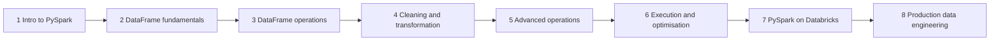

# 13 · Learning Roadmap: PySpark for Data Engineers

**← Previous** [12 · Real-World Use Cases](12-real-world-use-cases.md) · [🏠 Home](../README.md)

> From Python fundamentals to production pipelines in eight modules.

## Roadmap

| Module | Topics | You can then… |
| --- | --- | --- |
| **1 · Introduction to PySpark** | What is PySpark, Pandas vs PySpark, Spark architecture, SparkSession, Databricks compute and notebooks | Explain how Spark runs your code |
| **2 · DataFrame fundamentals** | Creating DataFrames, lists/tuples/dicts, Row and Column, `StructType` / `StructField`, explicit schemas | Build DataFrames with correct types |
| **3 · DataFrame operations** | `select`, `filter`, `withColumn`, `drop`, `distinct`, `dropDuplicates`, `groupBy`, `agg`, `orderBy` | Answer most business questions |
| **4 · Cleaning and transformation** | NULL handling, strings, dates and timestamps, type conversion, conditional logic | Build a Silver layer |
| **5 · Advanced operations** | Joins, `union` / `unionByName`, window functions, ranking, complex transformations | Model Gold tables |
| **6 · Execution and optimisation** | Lazy evaluation, narrow vs wide transformations, shuffles, partitions, cache/persist, explain plans, broadcast joins | Diagnose and speed up slow jobs |
| **7 · PySpark on Databricks** | CSV/JSON/Parquet, Delta tables, Unity Catalog, reading and writing tables, incremental processing, data quality | Work like a Databricks engineer |
| **8 · Production data engineering** | PySpark ETL pipelines, Bronze → Silver → Gold, Lakeflow Spark Declarative Pipelines, jobs and orchestration, monitoring | Ship reliable pipelines |

## Where this repository fits

| Roadmap module | Covered here |
| --- | --- |
| 1 | Concept chapters [05](05-apache-spark.md), [06](06-pyspark.md), [07](07-databricks-lakehouse-medallion.md) |
| 2–3 | [Chapter 08](11-hands-on-guide.md), [notebook 01](../notebooks/01_first_dataframe.py) |
| 4–5 | [Chapter 09](12-real-world-use-cases.md), [exercises](../exercises/README.md) |
| 6 | [Chapter 08](11-hands-on-guide.md#step-5-read-the-execution-plan), [notebook 02](../notebooks/02_lazy_evaluation_and_explain.py) |
| 7–8 | [Chapter 07](07-databricks-lakehouse-medallion.md), [Hands-On pipeline](11-hands-on-guide.md#bronze--silver--gold-pipeline), [notebook 04](../notebooks/04_medallion_pipeline.py) |

## Suggested next step

Take your finished **Retail Sales ETL project** (Bronze → Silver → Gold in SQL) and rebuild the same transformations in PySpark. You already understand the architecture and the SQL logic, so the focus is the new syntax. The local [medallion pipeline](../examples/local/retail_medallion_pipeline.py) is a template.

For a teacher-ready lesson, see the [90-minute session plan](../teaching/session-plan.md).

---

**← Previous** [12 · Real-World Use Cases](12-real-world-use-cases.md) · [🏠 Home](../README.md)
