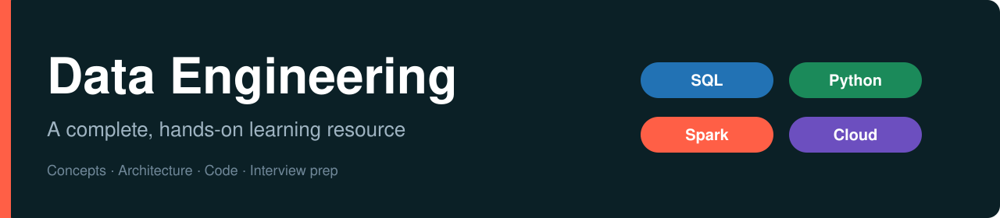

<div align="center">



</div>

# Data Engineering

A complete, hands-on learning resource for aspiring and practising data engineers: **concepts, architecture diagrams, runnable code and interview preparation**, organised as a sequence of modules.

## Learning path

| Module | Title | Status |
|---|---|---|
| **01** | [Introduction to Big Data and Data Engineering](01-introduction-to-big-data-and-data-engineering/README.md) | Available |
| 02 | SQL for Data Engineers | Planned |
| 03 | Python for Data Engineering | Planned |
| 04 | Data Modelling and Warehousing | Planned |
| 05 | Apache Spark and PySpark in Depth | Planned |
| 06 | Cloud Data Platforms and the Lakehouse | Planned |
| 07 | Orchestration and Pipelines | Planned |
| 08 | Streaming Data | Planned |
| 09 | Capstone Projects | Planned |

> The planned modules are suggestions. Edit this table to match your own roadmap.

## Module 01 at a glance

**Introduction to Big Data and Data Engineering** follows one story: *Excel → MySQL → Hadoop → Spark → PySpark → lakehouse*.

- 10 numbered topics, each with a business scenario, architecture diagrams, examples, takeaways and interview questions
- 40 professional diagrams (SVG and PNG)
- 6 runnable examples with real output
- Glossary, further reading and a module review with scenario-based interview practice

[Start Module 01 →](01-introduction-to-big-data-and-data-engineering/README.md)

## Repository structure

```text
Data-Engineering/
├── README.md
├── assets/                                      repository-level images
└── 01-introduction-to-big-data-and-data-engineering/
    ├── README.md                                module home
    ├── 01 ... 10 topic files (.md)
    ├── examples/                                runnable code
    ├── resources/                               glossary, further reading
    └── assets/diagrams/                         svg, png, and the source that draws them
```

Each future module will follow the same layout: `NN-module-name/` with its own README, numbered topic files, `examples/`, `resources/` and `assets/`.

## How to use this repository

1. Open a module's README and read the learning objectives.
2. Work through the numbered topics in order.
3. Run the examples, then try the exercises.
4. Test yourself with the interview questions.

## Contributing

Issues and pull requests are welcome: corrections, clearer explanations, better diagrams. Keep to the existing structure and style (business problem first, diagrams, examples, takeaways, interview questions).

## License

Add your preferred license here (for example, MIT).
